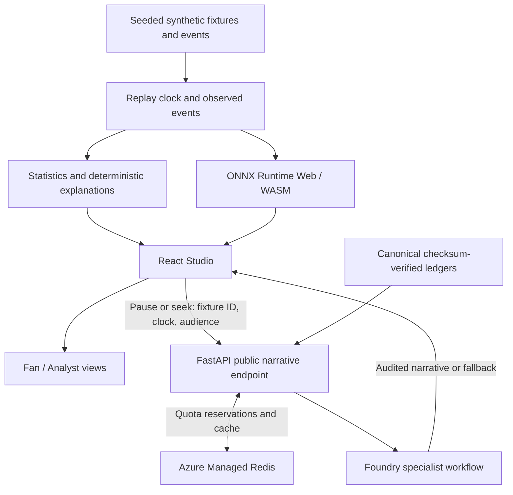
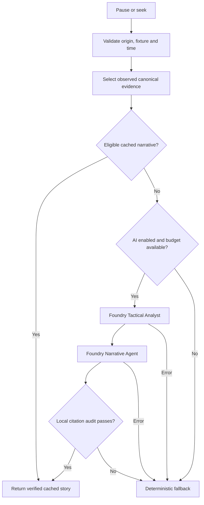
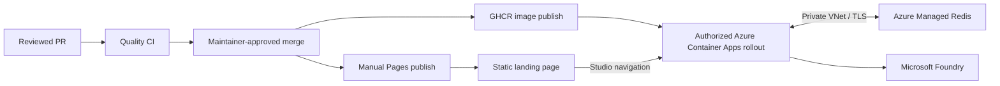
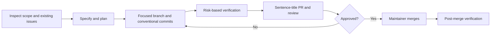

<div align="center">

# Matchwork — The Game, Understood

**Explainable, evidence-linked football intelligence for fans and analysts.**

Built for the Microsoft × Premier League Inside the Game: Developer Hackathon 2026.

[](https://github.com/Kanechiii/matchwork/actions/workflows/quality.yml)
[](https://react.dev/)
[](https://nodejs.org/)
[](https://onnxruntime.ai/)

[**Open Azure Studio**](https://matchwork-secure-demo.bluemeadow-70e920b0.japaneast.azurecontainerapps.io/#/studio) · [Landing page](https://kanechiii.github.io/matchwork/) · [Documentation](docs/README.md) · [Contributing](CONTRIBUTING.md)

</div>

> **Synthetic demonstration:** All teams, players and events are fictional. No live Premier League data or footage is ingested. ONNX classifier scores are illustrative, not calibrated real-match probabilities.

## Navigate

[Experience](#experience) · [Architecture](#architecture) · [AI workflow](#ai-workflow) · [Quick start](#quick-start) · [Repository map](#repository-map) · [Verification](#verification) · [Deployment](#deployment) · [Safeguards](#safeguards) · [Contributing](#contributing)

## Experience

Nine seeded 90-minute fictional fixtures become synchronized replay, football statistics, evidence-linked intelligence and match stories.

| Explore | What to try |
| --- | --- |
| Replay | Select a fixture; play, pause, restart or seek. Watch the score, event feed and statistics update. |
| Fan / Analyst | Switch audience and team focus; compare explanations and evidence without resetting replay. |
| Browser ML | Inspect the synthetic-trained ONNX classifier and its sampled timestamp. |
| Match story | Pause or seek in Azure Studio to request a bounded Foundry narrative; inspect source and cited event IDs. |

Open [Azure Studio](https://matchwork-secure-demo.bluemeadow-70e920b0.japaneast.azurecontainerapps.io/#/studio) (allow for cold starts). No login is needed for the bounded public narrative route. Availability depends on cloud configuration and quotas; deterministic stories remain available when AI is unavailable.

## Architecture



The five challenge stages are **ingest → interpret → explain → render → personalize**. The browser's replay engine remains deterministic; AI supplements rather than controls match truth. [Architecture details](docs/architecture.md).

## AI workflow



The public request contains only fixture ID, sampled clock and audience. The server validates against its own fixture ledger and selects the last five observed events; caller-authored match facts are not accepted. Cache entries are isolated by fixture, canonical digest, time and audience. Earlier eligible narratives retain their original as-of time. The citation audit checks provenance, not arbitrary prose truth. See [specialist workflow](docs/FOUNDRY_MULTI_AGENT.md).

<details>
<summary><strong>What happens when AI is unavailable?</strong></summary>

Browser ONNX CDN/WASM failure is disclosed without stopping replay, stats, feed or deterministic recaps. Foundry failures, disabled inference, rejected citations and exhausted budgets use a labeled rule-based fallback. Live Foundry is identified by `source: foundry` and `status: success`; a deterministic story is not evidence of a live model call.

</details>

## Quick start

Prerequisites: Node.js 24, npm and Python 3.12+ for the backend.

```powershell
git clone https://github.com/Kanechiii/matchwork.git
cd matchwork
npm ci
npm run dev
```

<details>
<summary><strong>Run the optional local backend</strong></summary>

In a separate terminal at the repository root:

```powershell
python -m pip install -r backend/requirements.txt
node scripts/exportReplay.mjs
python -m uvicorn backend.main:app --host 127.0.0.1 --port 8000
```

Keep `MATCHWORK_AI_ENABLED=false` in environments without approved credentials, trusted evidence and budget controls. Browser replay and deterministic explanations do not require paid AI credentials. See [API security](docs/PHASE7B_API_SECURITY.md).

</details>

## Repository map

| Path | Responsibility |
| --- | --- |
| [src/engine](src/engine/) · [src/data](src/data/) | Seeded simulation, fixtures, replay and statistics |
| [src/ai](src/ai/) | Browser ONNX model, features and explanations |
| [src/studio](src/studio/) · [src/landing](src/landing/) | Studio and landing experience |
| [src/services](src/services/) · [src/orchestration](src/orchestration/) | Public API client and deterministic workflow prototype |
| [backend](backend/) | FastAPI, canonical evidence, Foundry, quotas, audit |
| [scripts](scripts/) · [backend/tests](backend/tests/) | Regression tests, model training, replay export |
| [.github/workflows](.github/workflows/) | CI and authorized release workflows |
| [docs](docs/README.md) | Architecture and preserved engineering records |

## Verification

```powershell
npm ci
python -m pip install -r backend/requirements.txt
node scripts/exportReplay.mjs
npm run build
npm run lint
python -m unittest discover -s backend/tests -p 'test_*.py'
python -m backend.evaluate_agents
```

<details>
<summary><strong>Additional replay and intelligence checks</strong></summary>

```powershell
node scripts/verifyGenerator.mjs
node scripts/verifyStats.mjs
node scripts/verifyLeague.mjs
node scripts/verifyReplay.mjs
node scripts/verifyIntegration.mjs
node scripts/verifyIntelligence.mjs
node scripts/verifyWorkflow.mjs
```

[Quality CI](.github/workflows/quality.yml) additionally exercises offline Agent Framework construction, actual ONNX WASM inference, reproducible training, Pages paths and enterprise checks. CI is not proof of live Foundry availability or browser QA.

</details>

## Deployment



GitHub Pages serves a static landing page and redirects Studio navigation to Azure. It does not host the backend. Releases require separate authorization; consult [deployment evidence](docs/DEPLOYMENT_CURRENT.md) and [release checklist](docs/RELEASE_CHECKLIST.md).

## Safeguards

- Anonymous `POST /api/public/agents/insights` is limited to trusted synthetic evidence, exact-origin checks, shared Redis quotas and cache. Origin checks are not authentication.
- Administrative `/api/insights`, `/api/agents/insights` and browser operator routes retain protection; no server keys or Redis credentials belong in frontend code.
- Redis attempt limits, concurrency and Azure budget alerts are safeguards, not a hard spending cap or durable audit trail. Redis loss or other Foundry clients can bypass recorded attempts.
- Operator sessions are not production identity management. Synthetic models are not real-world validated; no official broadcast media is bundled.

[Cost controls](PHASE7_COST_GUARD.md) · [Protected API](docs/PHASE7B_API_SECURITY.md) · [Evaluation and observability](docs/FOUNDRY_EVALUATION_OBSERVABILITY.md)

## Contributing



Read [repository-wide agent instructions](AGENTS.md) and [contribution standards](CONTRIBUTING.md). PR titles use a plain sentence; commits and squash subjects use Conventional Commits. Historical records are preserved.

## Hackathon record

The original submission deadline was October 27, 2026, 11:59 PM Pacific. See the [historical submission checklist](docs/RELEASE_CHECKLIST.md) and [documentation index](docs/README.md). No new claim of submission, judging result, published video or approved license is made here.
