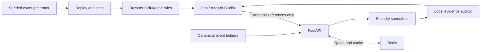

# Matchwork architecture

[README](../README.md) · [Contribution standards](../CONTRIBUTING.md) · [Historical documentation index](README.md)

## System boundaries

The engine and data modules establish synthetic truth; UI and inference must not change observed events. The browser ONNX classifier is synthetic-trained and illustrative. Foundry's two model-backed specialists use Python coordination and a local citation auditor, not a claim of framework-managed orchestration. The deterministic workflow prototype is distinct.

## Contracts

- Replay time and sampled inference time are separate; suppress stale results and future evidence.
- Public POST /api/public/agents/insights accepts match_id, as_of_seconds and audience; the backend selects observed evidence from checksum-verified ledgers.
- Protected administrative and operator routes remain separate. Origin enforcement is not authentication.
- Redis controls shared attempts and caches by fixture, digest, clock and audience; quota failure must not authorize paid inference.
- Deterministic fallback remains usable when model services fail; citation audit checks provenance, not arbitrary factual correctness.

## Deployment boundary

GitHub Pages is a static landing site; Studio routes to Azure Container Apps. The image is published through GHCR; cloud rollout and Pages publication require separate authorization. Redis and Foundry are server-side. See [deployment notes](DEPLOYMENT_CURRENT.md) and [API security](PHASE7B_API_SECURITY.md). No live deployment verification is implied by this architecture document.

## Change control

Review compatibility, data integrity, rollback and verification before changing contracts, model provenance, auth, quotas or deployment paths. Record approved architecture decisions here; keep project status and acceptance evidence in chat, executable tests and CI.
